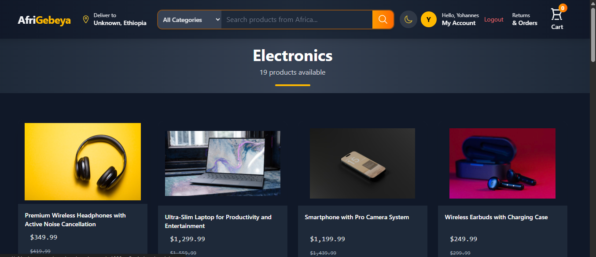
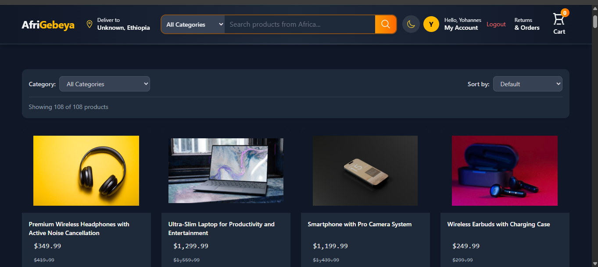
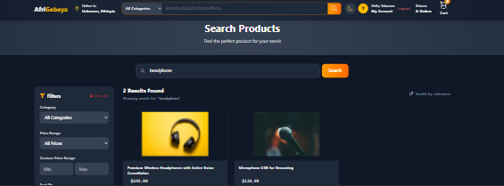
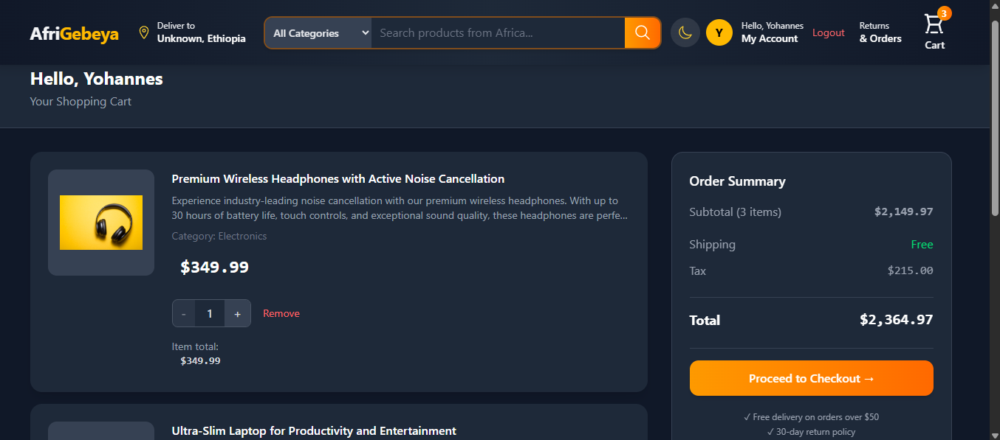
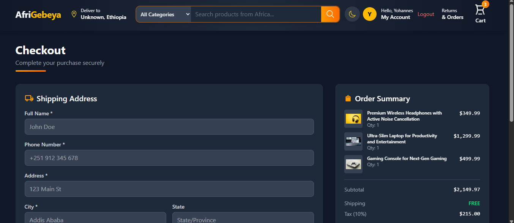
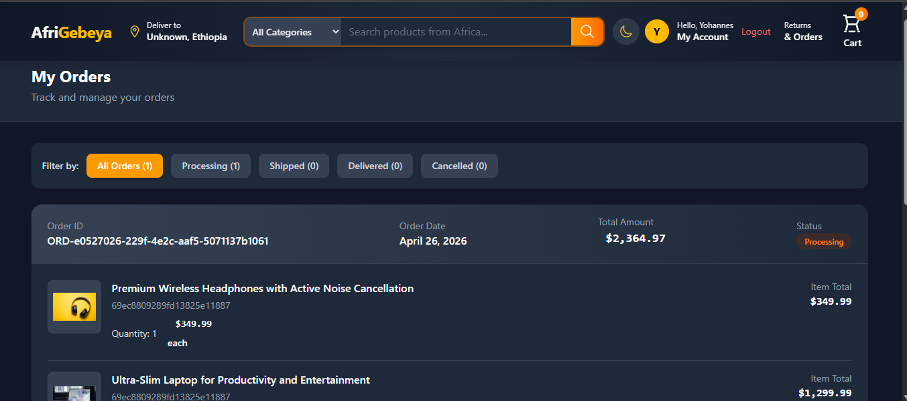
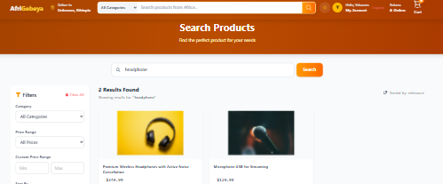

#  AfriGebeya - African Marketplace E-Commerce Platform

[](https://reactjs.org/)
[](https://nodejs.org/)
[](https://www.mongodb.com/)
[](https://tailwindcss.com/)
[](https://stripe.com/)
[](LICENSE)

## 📱 Live Demo

[](https://afrigebeya.vercel.app)

## 🖼️ Screenshots

### Home Page


### Category Page


### Products Page


### Each Product Page


### Search Page


### Cart Page


### Payment Page


### Orders Page


### Light Theme Page



## 🎯 Overview

**AfriGebeya** is a full-stack e-commerce platform built for the African marketplace. The name combines "Afri" (Africa) and "Gebeya" (meaning to buy/sell in Amharic), representing a digital marketplace connecting African artisans, sellers, and buyers across the continent.

This platform provides a seamless shopping experience with features like product browsing, shopping cart, secure payment processing, order tracking, and user authentication.

### ✨ Key Highlights

- ✅ Complete e-commerce functionality
- ✅ Dark/Light mode support
- ✅ Responsive design for all devices
- ✅ Secure payment integration with Stripe
- ✅ JWT authentication
- ✅ Real-time order tracking
- ✅ Advanced search and filters
- ✅ User-friendly dashboard

## 🚀 Features

### User Features
- 🔐 **Authentication** - Register, login
- 🛍️ **Product Browsing** - Browse products by categories
- 🔍 **Advanced Search** - Search products with filters (price, category, sorting)
- 🛒 **Shopping Cart** - Add/remove items, update quantities
- 💳 **Payment Processing** - Secure Stripe payment integration
- 📦 **Order Management** - View order history and track status
- 🌙 **Dark/Light Mode** - Theme toggle with localStorage persistence
- 📱 **Responsive Design** - Mobile-first approach

### Admin Features
- 📝 **Product Management** - Create, update, delete products
- 📊 **Order Management** - Update order status, track shipments

## 🛠️ Tech Stack

### Frontend
| Technology | Version | Purpose |
|------------|---------|---------|
| React | Latest | UI Framework |
| Tailwind CSS | Latest | Styling |
| React Router DOM | Latest | Routing |
| Axios | Latest | API calls |
| React Icons | latest | Icons |
| Stripe.js | Latest | Payment integration |
| React Responsive Carousel | Latest | Product carousel |

### Backend
| Technology | Version | Purpose |
|------------|---------|---------|
| Node.js | Latest | Runtime |
| Express.js | Latest | Web framework |
| MongoDB | Latest | Database |
| Mongoose | Latest | ODM |
| JWT | Latest | Authentication |
| Bcryptjs | Latest | Password encryption |
| Stripe | Latest | Payment processing |

### DevOps & Tools
- **Frontend Hosting**: Vercel 
- **Backend Hosting**: Render
- **Database**: MongoDB Atlas
- **Version Control**: Git & GitHub
- **Payment Testing**: Stripe Test Cards

## 💻 Installation

### Prerequisites

- Node.js (v18 or higher)
- MongoDB (local or Atlas)
- Stripe Account (for payments)

### Clone the Repository

```bash
git clone https://github.com/yohannes-wegayehu/CodeAlpha_Ecommerce_store.git
cd CodeAlpha_Ecommerce_store
```
### Backend Setup
```bash
# Navigate to server directory
cd server

# Install dependencies
npm install

# Run in development mode
nodemon server.js

# Run in production mode
node server.js
```
### Frontend Setup
```bash
# Navigate to client directory
cd client

# Install dependencies
npm install

# Create .env file

# Run development server
npm run dev

# Build for production
npm run build
```

### 🔧 Environment Variables

#### Backend (.env)
```bash
# Server Configuration
PORT=5000

# Database
MONGODB_URI = your_mongoDB URL

# JWT Authentication
JWT_SECRET = your_super_secret_jwt_key_minimum_32_characters

# Stripe Payment
STRIPE_SECRET_KEY = sk_test_your_stripe_secret_key

# Frontend URL (CORS)
FRONTEND_URL=https://afrigebeya.vercel.app
```
#### Frontend (.env)
```bash
VITE_STRIPE_KEY = your_stripe_key
VITE_BACKEND_URL = your_backend_url || http:localhost:5000/api
```
## 👨‍💻 Author

- Name: Yohannes John
- Linkdin: [@yohannes-wegayehu](https://linkedin.com/in/yohannes-wegayehu)
- Email: yohanneswegayehu21@gmail.com
